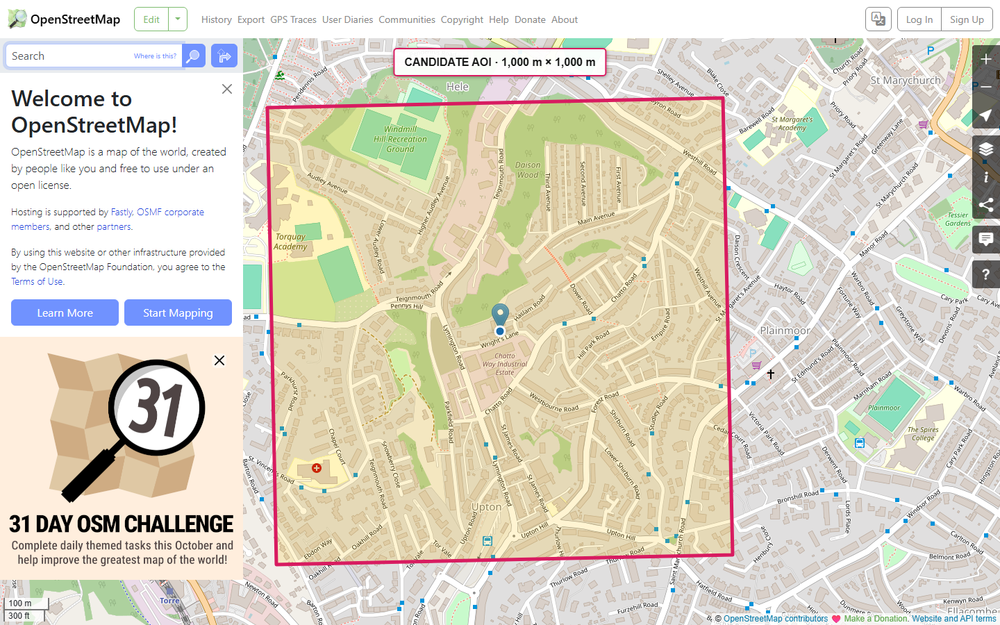

# TVW-006 — AOI candidate selection

**Original 500 m scope:** PASS after Luna fix 1 and independent review. M2 is not complete. The original 500 m calculation, screenshot and review record below are preserved as historical evidence; the user-approved 1 km revision is recorded at the end of this handback.

## Implemented

- Added a pinned, isolated Python AOI tool using pyproj 3.8.0. It validates the editable config, transforms WGS84 longitude/latitude to EPSG:27700 with `always_xy=True`, calculates a 500 m × 500 m candidate square, and writes the projected center and bounds back to the config.
- Added strict validation and an offline CLI with `validate-aoi` and `select-aoi` commands. PROJ network access is disabled before transformations. Outputs are staged to sibling temporary files and atomically replaced.
- Generated `docs/aoi-selection.json`, RFC 7946 `docs/aoi-selection.geojson` with a closed counter-clockwise polygon and anchor point, and this report. Re-running the selection command produces identical output hashes.
- Kept `selection_status` as `selected_pending_coverage` and `coverage_status` as `not_checked`. The selection is a candidate, not coverage-approved or frozen.
- No EA elevation, OSM/OS extracts, transformation grids, GIS source assets, or geographic browser behavior were added. The existing synthetic M0/M1 viewer remains unchanged.

## Anchor and transformation

Postcodes.io returned quality 1 for postcode centroid TQ1 4HN on 2026-10-17: longitude `-3.536013`, latitude `50.477853`; its rounded BNG values were easting `291110`, northing `65355`. A postcode centroid is not a property or survey point. The provider documentation describes its Great Britain source data as using the OS OpenData licence; see the [Postcodes.io API documentation](https://postcodes.io/docs/).

pyproj returned candidate center easting `291108.9018176432 m`, northing `65353.48350844931 m`. Bounds in `[west, south, east, north]` order are `[290858.9018176432, 65103.48350844931, 291358.9018176432, 65603.48350844931] m`. The CLI explicitly selects EPSG operation 1314 (OSGB36 to WGS 84 (6)) plus EPSG operation 19916 (British National Grid), a non-ballpark operation reporting 2 m accuracy. It selects by operation identity, independent of candidate ordering or local grid presence. PROJ network access was off. The selected operation uses no grid; `TransformerGroup.best_available` is `false` because the preferred 1 m operation is unavailable without `uk_os_OSTN15_NTv2_OSGBtoETRS.tif`. That missing operation/grid is recorded in the generated JSON alongside the selected name, definition, reported accuracy and grid-use state. No transformation grid was downloaded.

## Map context evidence

The original zoom 18 screenshot is a dated historical anchor-context capture, showing the postcode marker only; it does not show the candidate boundary. At the time it was inspected, visible context included Wrights Lane, Haslam Road, Chatto Way, and Charito Road. This establishes map context only; it does not establish EA elevation coverage or local feature density.

Map data © [OpenStreetMap contributors](https://www.openstreetmap.org/copyright), licensed under ODbL. This marker-only screenshot was viewed in Playwright Chromium 156.0.8078.4 at 1440 × 900 CSS pixels and device scale factor 1. Twenty-four tiles loaded, the attribution was visible, and no page errors were reported. It remains preserved at `docs/milestones/screenshots/TVW-006-postcode-context.png` as historical 2026-10-17 anchor context.

### Candidate-boundary inspection (Luna fix 1; original 500 m evidence)

The original 500 m screenshot overlays the exact Polygon coordinates from the then-current generated `docs/aoi-selection.geojson` on the independent OpenStreetMap page. The styling uses a magenta 5 px outline, translucent amber fill, and a centered `CANDIDATE AOI · 500 m × 500 m` label. The capture URL is `https://www.openstreetmap.org/?mlat=50.477853&mlon=-3.536013#map=17/50.477853/-3.536013` (zoom 17), captured in Chromium 156.0.8078.4 at 1440 × 900 CSS pixels, device scale factor 1. Thirty-five map tiles loaded, the visible attribution reads “© OpenStreetMap contributors,” and no browser page errors occurred. The screenshot was visually inspected.

The full historical 500 m square is visible. Its context includes Wrights Lane, Haslam Road, Chatto Way, Charito Road and Stantaway Allotments, with nearby residential streets around the eastern and southern edges. This is visual context for the candidate at that time only; it does not confirm EA DTM coverage, feature counts, or dataset availability. The original boundary screenshot remains at `docs/milestones/screenshots/TVW-006-aoi-boundary.png`. The generated `docs/aoi-selection.md` uses a map link derived from the currently configured WGS84 anchor and makes no fixed road/landmark assertions.

## User-approved 1 km size revision (2026-10-17)

The user authorized changing the candidate from 500 m × 500 m to **1,000 m × 1,000 m** around the same TQ1 4HN postcode centroid. The WGS84 anchor remains longitude `-3.536013`, latitude `50.477853`; the pinned EPSG:1314 + EPSG:19916 operation continues to return center easting `291108.9018176432 m`, northing `65353.48350844931 m`. The updated EPSG:27700 bounds are `[290608.9018176432, 64853.48350844931, 291608.9018176432, 65853.48350844931]` in west, south, east, north order. The config validator requires exactly 1,000 m in both dimensions. Status remains `selected_pending_coverage` / `not_checked`.

The deterministic AOI outputs were regenerated from the configured center. At a future 2 m spacing, the candidate would use 501 × 501 = 251,001 samples; this revision does not export a heightfield or real browser world. No EA DTM or other geographic source data was acquired or inspected. The synthetic viewer and JavaScript dependencies were not changed.

The new screenshot overlays the exact generated `docs/aoi-selection.geojson` polygon on OpenStreetMap, with a magenta 5 px outline, translucent amber fill, a 1,000 m × 1,000 m label and a center marker. It was captured at `https://www.openstreetmap.org/?mlat=50.477853&mlon=-3.536013#map=16/50.477853/-3.536013` (zoom 16) in Playwright Chromium 156.0.8078.4, at 1440 × 900 CSS pixels and device scale factor 1. Twenty-eight map tiles loaded, visible attribution reads “© OpenStreetMap contributors,” and no browser page errors occurred. Visual inspection showed the full boundary and center marker over the mapped residential street network and green spaces. This is map context only; it does not establish EA coverage or feature counts.

The prior 500 m screenshot and 2026-10-17 inspection remain intact at `docs/milestones/screenshots/TVW-006-aoi-boundary.png`. Sol's independent review returned **PASS** for the 1 km size revision on 2026-10-17. The review confirmed the center and pinned operation are unchanged, bounds are exactly ±500 m, generated outputs are deterministic, invalid stored values are rejected, and the screenshot shows the full boundary and visible attribution. The candidate remains unverified for source coverage; this review does not mark M2 complete. TVW-007 is authorized as the next issue.

## Verification of original 500 m scope

Independent Sol review returned **PASS** after checking the previously reported validation, transformation-operation, and boundary-map findings. Adversarial CLI cases rejected missing, malformed, stale and inconsistent projected values; anchor-only changes were regenerated by `select-aoi`. The reviewer also independently reran the Python/Ruff and Node/Playwright gates and inspected the boundary screenshot.

The isolated environment used Python 3.13.7 with pyproj 3.8.0, pytest 9.1.1, and Ruff 0.17.1. All direct and transitive requirements are pinned in `pipeline/requirements.txt`; `pip check` found no broken requirements.

- `pipeline\.venv\Scripts\python.exe -m pip install -r pipeline\requirements.txt` — passed.
- `pipeline\.venv\Scripts\python.exe -m pip check` — passed.
- From `pipeline/`, `.\.venv\Scripts\python.exe -m pytest tests` — 37 passed after Luna fix 1, covering malformed and stale stored values, anchor-only regeneration, pinned operation selection, missing-grid diagnostics, and center-derived map links.
- From `pipeline/`, `.\.venv\Scripts\ruff.exe check torquay_pipeline tests` — passed.
- From `pipeline/`, `.\.venv\Scripts\ruff.exe format --check torquay_pipeline tests` — passed.
- The coordinate API follows the [official pyproj Transformer documentation](https://pyproj4.github.io/pyproj/stable/api/transformer.html), with `always_xy=True` for both directions.
- `npm.cmd run typecheck`, `npm.cmd run lint`, `npm.cmd run format:check` — passed.
- `npm.cmd test` — 92 tests passed across 6 files.
- `npm.cmd run build` — passed; Vite emitted the existing advisory for a 584.08 kB minified JavaScript chunk.
- `npm.cmd run test:e2e` — 3 Chromium tests passed, including M0 and synthetic heightfield navigation/recovery.
- `npm.cmd run preview -- --host 127.0.0.1` — actual Chromium 156.0.8078.4 loaded `/` (terrain mode) and `/?world=m0`; both reached `data-renderer-ready="true"` on the viewer shell with one canvas at 1440 × 900 CSS pixels, DPR 1.5, and a 2160 × 1350 backing buffer. No page errors, failed requests or HTTP error responses were recorded.
- From `pipeline/`, `select-aoi` was run twice and `validate-aoi` once; outputs were identical. SHA-256: config `053EE03CB56B95B01164F8F3711F7165C40BC1F600CB1AC2967BB6BD64FFEEB5`, JSON `E756C009751574DE8628F486DD0B588591E175EF214725FBCEF2FCAADC01827F`, GeoJSON `2460C7B8996A085B14E600FC0E596DC6B0EFD812037E955F96EA6542E67EFAFD`, Markdown `946FF9BE0586002A6349D9BE8F4BB3F600764314722F73BAA28676335A0BF81D`.
- The boundary screenshot was captured and inspected in actual Chromium 156.0.8078.4 at zoom 17, 1440 × 900 CSS pixels/DPR 1; 35 tiles loaded, the exact generated GeoJSON polygon was drawn, visible OSM contributor attribution was confirmed, and no page errors occurred.
- The supplied source plan remains byte-identical: SHA-256 `144C9C704EA1C10FA2D503DBA3233B089528585BE7D36B7B94164D28BA40D571`.

## Verification of 1 km size revision

- From `pipeline/`, `$env:PROJ_NETWORK='OFF'; .\.venv\Scripts\python.exe -m torquay_pipeline.cli validate-aoi --config ..\config\aoi.torquay.json` — exit 0; the configured anchor and stored 1 km projection validate, with coverage still `not_checked`.
- From `pipeline/`, `select-aoi` was run twice with `PROJ_NETWORK=OFF`; the generated config, JSON, GeoJSON and Markdown hashes matched byte-for-byte across both runs. Current SHA-256 values: config `0CC3C9DA4F9B53F79D33D6CA464B4D3EF2A16C7DC4CF54E1E3174145BC7EEB85`, JSON `C46B4A8AB2F09688CE52C5D4566ADFAA2200926E63BEFD79FA0225A45139DAA2`, GeoJSON `333140DE677E6BC833CD4B6F0FC60C65E5F6731B9469440745BB3A21212CD2F8`, Markdown `4D4D6882134D27A5403E9431A969E019A851F54ADC044BA87D2FBD1A45710360`.
- From `pipeline/`, `.\.venv\Scripts\python.exe -m pytest tests` — 38 passed, including exact 1 km bounds and rejection of incorrect width and height. `.\.venv\Scripts\ruff.exe check torquay_pipeline tests` and `.\.venv\Scripts\ruff.exe format --check torquay_pipeline tests` — passed.
- `npm.cmd run typecheck`, `npm.cmd run lint`, `npm.cmd run format:check`, `npm.cmd test`, `npm.cmd run build` — passed; Vitest reports 92 tests across 6 files. Build retains the existing advisory for its 584.08 kB minified JavaScript chunk.
- `npm.cmd run test:e2e` — 3 Chromium tests passed for the existing M0 and M1 synthetic viewer flows. E2E regenerated the M0/M1 screenshots; the original committed captures were restored and their SHA-256 hashes verified unchanged. No files under `src/`, `public/`, `package.json` or `package-lock.json` changed.
- The new OSM overlay screenshot was captured with headless Playwright Chromium 156.0.8078.4 at URL `https://www.openstreetmap.org/?mlat=50.477853&mlon=-3.536013#map=16/50.477853/-3.536013`, zoom 16, 1440 × 900 CSS pixels, DPR 1. Twenty-eight tiles loaded, attribution was visible, and no page errors occurred. The full generated polygon, its 1,000 m label and the unchanged center marker were visually inspected. SHA-256: `06AC9F10EB6E5CC14FFA27852CD2C7009223FFE8A85620A4CDE653A22098B6C4`.
- Original 500 m boundary screenshot SHA-256 remains `A52359DE2215C45C6117AAC09822958EAC77BD2528024C0599785732E3D19FE2`; marker-only historical image SHA-256 is `C1378BB644AD462F956DEBC8C206C0CA2FCD774DDEF13349BF91AC70120A6B9A`. After E2E regenerated M0/M1 screenshots, their originals were restored and rechecked: M0 `E236BB1D61B85C137D7B039EC2833D1B4AD146DF8D9E51BB6C87C5D99555C994`; M1 `58EA05EA63BF097AB4BE346419AA4818AA80F76AD936C6F3E3408392078EFE2E`. The supplied source plan remains byte-identical with SHA-256 `144C9C704EA1C10FA2D503DBA3233B089528585BE7D36B7B94164D28BA40D571`.

## Limits and next step

EA DTM coverage, NoData, OSM/OS feature counts, and dataset availability were not checked during TVW-006. The candidate remains `selected_pending_coverage`; do not mark M2 complete or freeze this AOI before TVW-007 coverage/source inspection. TVW-007 is the next authorized issue.
