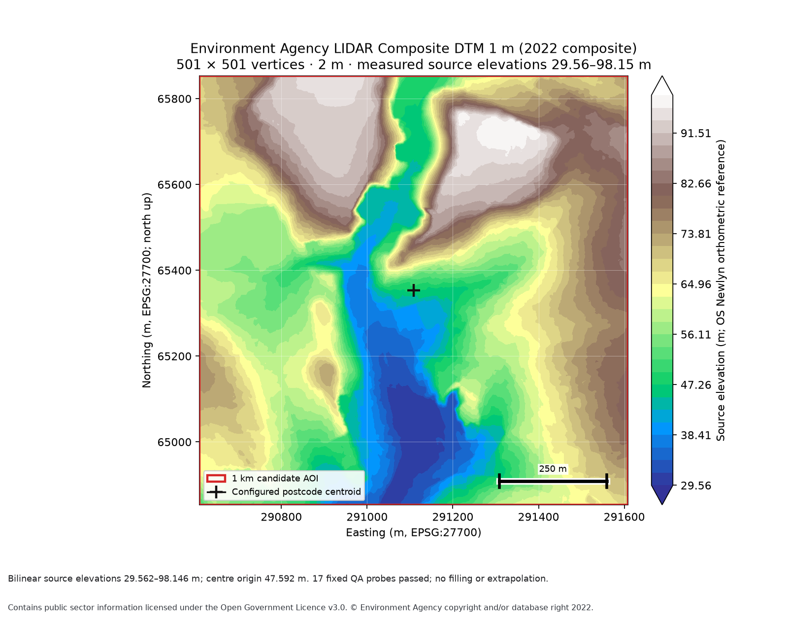
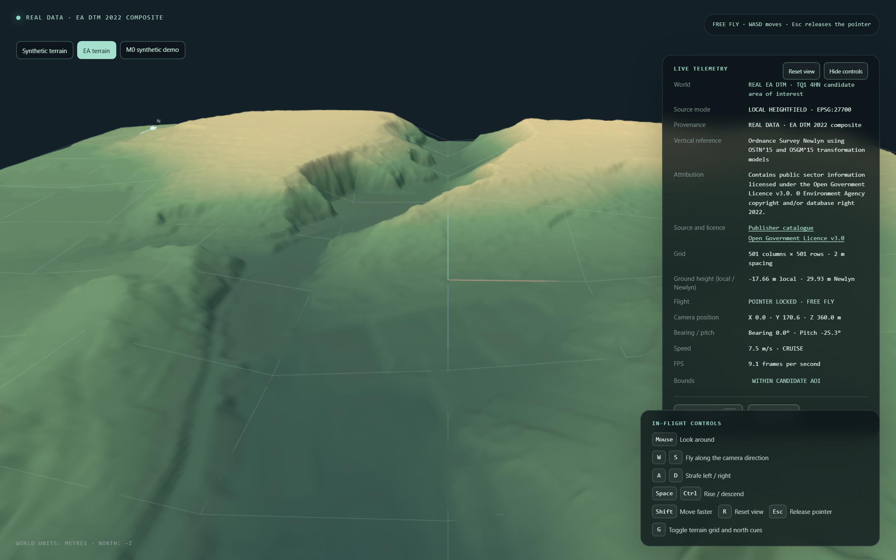

# TVW-008: Local EA terrain package and viewer

Date: 2026-10-17
Status: PASS after fix round 2 and independent Sol review

TVW-008 builds the verified Environment Agency elevation tiles into a deterministic local 2 m heightfield and adds an optional local real-terrain mode. The synthetic heightfield remains the default, and `/?world=m0` still opens the analytic synthetic demo. This does not complete M2 or approve/freeze the AOI: `selection_status` is still `selected_pending_coverage` and overall `coverage_status` is still `not_checked` because OSM/OS building and road checks remain outstanding.

## Source and resampling

The builder rechecks the two archives and their selected TIFF/XML members against `data/source-manifest.json`, then inspects the GeoTIFFs and requires the supported north-up 1 m EPSG:27700 affine. The local raw downloads remain ignored under `data/raw/ea_dtm/`; the generated browser package is ignored under `public/worlds/torquay-poc-001/` and is not committed.

The inputs are Environment Agency LIDAR Composite DTM 1 m (2022 composite), acquired from the public survey portal on 2026-10-17. Tile-specific XML records a 2003-02-14 through 2022-05-05 survey range, EPSG:27700 and metre elevations referenced to Ordnance Survey Newlyn using OSTN 15 and OSGM 15. This is source metadata, not a vertical datum inferred from the horizontal CRS. The publisher-wide product range is 2000-06-06 through 2022-04-02. Attribution follows the XML `useLimit`: Environment Agency copyright/database right 2022 under the Open Government Licence v3.0. The source manifest records the conflicting XML `idCredit` year as a metadata inconsistency.

The output is a 501 × 501 vertex lattice at 2 m spacing over the exact 1,000 × 1,000 m candidate bounds. Each vertex is bilinearly sampled from the source area-pixel centers. Sampling crosses the northing 65000 m seam between `SX96nw` and `SX96sw`; every positive-weight contributor must be valid. NoData, uncovered contributors, filling and extrapolation fail the build. The center sample, 47.59241548392676 m Newlyn, is the deterministic vertical origin. The output values are relative to that origin, row-major north-to-south little-endian Float32, exactly 1,004,004 bytes.

The generated source TIFF members are `SX96nw_DTM_1m.tif` (SHA-256 `665441c4022f06044e17b501e6e1fe4bf3a2c25f87a7f2fea91c01c1054ba8e1`) and `SX96sw_DTM_1m.tif` (SHA-256 `8438a544a9f4b4c675d72fd16824d5b75802899e7291edb585e98334da53211f`). Their archive names, portal URLs, download dates, byte lengths and hashes are embedded in the manifest and tracked source manifest.

QA independently compares the exported source interpolation against direct raster pixel-center reads for the four AOI corners, center, both sides of the source seam and ten fixed-seed vertices. All 17 probes passed. The maximum observed resampling difference is 2.842170943040401e-14 m; the maximum separate Float32 quantization error is 1.764989647767834e-6 m. EA DTM cell coverage was revalidated at 1,000,000 of 1,000,000 AOI cells, with no missing/invalid contributors. This is the EA DTM result only; it does not update overall AOI status.

The build writes a deterministic real-world manifest, QA report and north-up PNG preview. Outputs are staged before replacement; the manifest is published last, and the transaction restores previous files if publication fails. Two consecutive builds produced byte-identical outputs. The generated heightfield SHA-256 is `1d0a9f27d9e150a422541b3ba2bd175f05d18c5ef58f8d8f4a4f586694c48183`.

## Browser evidence

The browser loads `/worlds/torquay-poc-001/manifest.json` and `heightfield.f32` through the local Vite origin. It verifies the generic real/synthetic manifest, binary SHA-256 and Float32 decoding before creating the mesh. The real HUD shows source mode, EA attribution, the Newlyn vertical reference, local relative height and calculated Newlyn elevation. The terrain uses a terrain color ramp, 100 m guide grid, north cue and camera clipping suitable for the 1 km view. The grid and wireframe controls, free-flight controls, reset and Escape behavior remain available.

Playwright Chromium evidence for fix round 1: browser version **156.0.8078.4**, 1440 × 900 CSS viewport, device pixel ratio 1.5, and 1440 × 900 terrain canvas backing size (real mode caps pixel ratio at 1 to reduce software-renderer load). The full E2E run identified `ANGLE (Google, Vulkan 1.3.0 (SwiftShader Device (Subzero) (0x0000C0DE)), SwiftShader driver)`. After a 2.5 s warm-up, seven 250 ms samples were **9.1, 9.7, 9.1, 8.3, 9.1, 8.8 and 8.6 FPS**, with a **9.1 FPS median**, below the 30 FPS target on this software renderer. The fix round 2 E2E screenshot's live HUD reads 9.1 FPS and shows the exact provenance badge `REAL DATA · EA DTM 2022 composite`. Independent Sol review also reproduced seven 60 FPS samples with Chrome 155 on the NVIDIA GeForce RTX 4070 SUPER using ANGLE Direct3D11; that hardware-renderer result meets the 30 FPS target on this host, while the SwiftShader result remains a separate software-renderer limitation. During the real-mode E2E run, holding W moved the camera from Z 360.00 m to 354.58 m and changed sampled ground from −17.6587 m to −17.6870 m local; the test compared both against the local Float32 mesh, then exercised boost state, mouse look, R reset, Escape pointer release and post-release held-key cleanup.

The saved screenshot shows the loaded EA terrain and live HUD in pointer lock:

The browser test also forces a local manifest 404, checks the displayed local build instructions, and returns to the functioning synthetic terrain. That error path is deliberate test coverage, not evidence of an unavailable real package during the successful real-mode run.

## Verification

Initial implementation verification on 2026-10-17:

- From `pipeline`, `.\.venv\Scripts\python.exe -m pytest tests`: 72 passed. `.\.venv\Scripts\python.exe -m ruff check .`, `.\.venv\Scripts\python.exe -m ruff format --check .`, and `.\.venv\Scripts\python.exe -m pip check` all passed.
- `npm.cmd run typecheck`, `npm.cmd run lint`, `npm.cmd run format:check`, and `npm.cmd test` passed; Vitest reported 6 files and 101 tests.
- `npm.cmd run build` passed. Vite emitted a non-failing chunk-size advisory for the 597.70 kB JavaScript bundle (151.85 kB gzip).
- `npm.cmd run test:e2e` passed all 5 Chromium tests in 1.2 minutes, covering the M0 synthetic demo, synthetic heightfield, local EA terrain, missing/corrupt package errors and recovery.
- `npm.cmd run generate:synthetic-heightfield` reproduced the two committed fixtures. The 3 × 3 fixture SHA-256 is `4e5e18b484af53448acdee1bffed54035c3bef7607381c3249ce255f2e2ceb14`; the 25 × 19 demo SHA-256 is `cf57dd9d5551eaad413c5e1ea43c8d2f9acb709c410bb016e8fbf7afd95dcd3b`.
- From `pipeline`, `.\.venv\Scripts\python.exe -m torquay_pipeline.cli build-terrain` reproduced identical manifest, binary, QA and preview hashes on consecutive runs. The generated binary remains ignored and untracked.
- A clean-clone build was simulated by temporarily moving the ignored real package out of `public/`; `npm.cmd run build` copied the synthetic heightfield exactly and did not include `torquay-poc-001/`. The ignored package was restored afterward.
- `npm.cmd run preview -- --host 127.0.0.1 --port 4174` served the production build. Installed Google Chrome 155 loaded the default synthetic world, switched to the real EA package, then returned to synthetic; the run reported no console or page errors (1440 × 900 viewport, DPR 1, 1440 × 900 canvas).
- Production build copied both synthetic fixture binaries and the ignored real terrain binary byte-for-byte. The clean-clone build omitted the real package and retained the synthetic fixture. The original supplied plan SHA-256 still matches `144C9C704EA1C10FA2D503DBA3233B089528585BE7D36B7B94164D28BA40D571`; M0/M1 screenshots were restored from `HEAD` after Playwright regenerated them.

## Fix round 1 review corrections

The real manifest validator now rejects computed span or midpoint overflow and checks that the finite AOI bounds, fixed 1,000 m square, projected center, 1,000 m extent, 501 × 501 dimensions and 2 m spacing agree. Regression cases cover mismatched width/depth, shifted bounds and extreme finite endpoints. The source seam QA probes now come from actual source raster boundaries intersecting the output lattice; a valid single-tile AOI runs without an assumed seam, while unsupported source coverage reports a contextual CLI error.

The real manifest now carries and validates the downloaded byte length, generator/version, WGS84 anchor and AOI, selected coordinate operation and its reported accuracy, and the missing preferred OSTN grid caveat, catalogue/product survey range, and XML copyright inconsistency. The HUD exposes accessible catalogue and licence links. E2E now waits for the actual WebGL backing-buffer resize and exercises a corrupted real binary checksum, Retry, and return to the functioning synthetic world.

Fix round 1 verification on 2026-10-17:

- From `pipeline`, `.\.venv\Scripts\python.exe -m pytest tests`: **75 passed**. `ruff check .`, `ruff format --check .` and `pip check` passed in the isolated pipeline environment.
- `npm.cmd run typecheck`, `npm.cmd run lint`, `npm.cmd run format:check` and `npm.cmd test` passed; Vitest reported **6 files, 143 tests**.
- `npm.cmd run build` passed. Vite emitted a non-failing chunk-size advisory; the JavaScript bundle is 607.65 kB (154.50 kB gzip).
- `npm.cmd run test:e2e` passed **6/6 Chromium tests**, including canvas backing-buffer resize, corrupt binary checksum and retry/recovery. The browser report records the SwiftShader renderer and 9.1 FPS median above. The final real-mode screenshot was inspected; the M0/M1 screenshots were restored to their original hashes after Playwright updated them.
- Two consecutive local `build-terrain` runs produced matching manifest, QA and preview hashes: `95B4DBD4434FA016E425294B8A4C9F97B1916E6FD552E656825A8403A27D1625`, `45AFFE371B9B13C4F1D7B6A979FA32C2C23BFF20D6A15BE6AEC2B966B4660AE2`, and `37D36C5F6577F3130A881B0CD7CEA5136872530CB61E76AC299D5756BDADAE9D`. The ignored heightfield is `1D0A9F27D9E150A422541B3BA2BD175F05D18C5EF58F8D8F4A4F586694C48183` on both runs. The production binary copies match their public source files byte-for-byte.
- `docs/Torquay_JS_Virtual_World_PoC_Codex_Plan.md` remains byte-identical with SHA-256 `144C9C704EA1C10FA2D503DBA3233B089528585BE7D36B7B94164D28BA40D571`. AOI approval remains pending; no M2 completion is claimed.

## Fix round 2 review corrections

The real manifest now carries the WGS84 polygon exterior ring verbatim from `docs/aoi-selection.geojson`, with `EPSG:4326`, `longitude-latitude` coordinate order and explicit Polygon type. The Python exporter confirms that feature still matches the configured AOI before publishing it. The TypeScript validator checks the ring is present, has four finite in-range corners plus a repeated closing coordinate, and exactly matches the candidate ring corresponding to the fixed EPSG:27700 bounds; it performs no coordinate transformation.

The coordinate-operation validator now normalizes whitespace and compares the complete PROJ pipeline against the pinned EPSG:1314 + EPSG:19916 candidate. Regressions reject both the changed Transverse Mercator central meridian (`lon_0=-2` to `lon_0=20`) and altered Helmert translation (`x=446.448` to `x=446.4489`), while accepting the generated definition.

Fix round 2 verification on 2026-10-17:

- From `pipeline`, `.\.venv\Scripts\python.exe -m pytest tests`: **77 passed**; Ruff check, format check and `pip check` passed.
- `npm.cmd run typecheck`, `npm.cmd run lint`, `npm.cmd run format:check`, and `npm.cmd test` passed; Vitest reported **6 files, 155 tests**. `npm.cmd run build` passed with a non-failing bundle advisory (609.64 kB JavaScript, 155.20 kB gzip).
- `npm.cmd run test:e2e` passed **6/6 Chromium tests**. The final run reported Chrome 156.0.8078.4, SwiftShader, 1440 × 900 CSS and canvas backing sizes at DPR 1.5, and seven 9.1 FPS samples. I inspected the updated [browser screenshot](screenshots/TVW-008-real-terrain.png), which shows the loaded EA terrain, attribution, catalogue/licence links, controls, and the 9.1 FPS HUD. M0/M1 screenshots were restored to their original hashes: `E236BB1D61B85C137D7B039EC2833D1B4AD146DF8D9E51BB6C87C5D99555C994` and `58EA05EA63BF097AB4BE346419AA4818AA80F76AD936C6F3E3408392078EFE2E`.
- Two consecutive actual exports produced identical manifest `A398E519EE8537AF3BCDCDB781A1501A3E0F45E58E47A4BDD2A986E15A06788F`, heightfield `1D0A9F27D9E150A422541B3BA2BD175F05D18C5EF58F8D8F4A4F586694C48183`, QA `45AFFE371B9B13C4F1D7B6A979FA32C2C23BFF20D6A15BE6AEC2B966B4660AE2`, and preview `37D36C5F6577F3130A881B0CD7CEA5136872530CB61E76AC299D5756BDADAE9D` SHA-256 values. The manifest's AOI ring compares byte-for-value with the source GeoJSON ring.
- The original supplied plan remains byte-identical with SHA-256 `144C9C704EA1C10FA2D503DBA3233B089528585BE7D36B7B94164D28BA40D571`. AOI approval remains pending and M2 is incomplete.

The original supplied plan remains unchanged; its recorded SHA-256 is `144C9C704EA1C10FA2D503DBA3233B089528585BE7D36B7B94164D28BA40D571`.

## Limits and next step

The checked-in repository contains no EA raster binary. To use real mode on a clean clone, restore the exact source files using `docs/data-sources.md`, then run `build-terrain` from `pipeline`; until then, the app displays a recoverable local-package error and the synthetic world remains available. No OSM/OS data, buildings, roads, alternate AOI, or remote browser service was added. M2 coverage approval remains pending OSM/OS feature checks.

## Independent review and disposition

Independent Sol review returned **PASS** on 2026-10-17 for fix commit `9af15aa`. The review verified the malformed/overflowing manifest regressions, full pinned-operation parameter checks, WGS84 polygon provenance and validation, seam and single-tile export behavior, corrupt-binary recovery, actual-source deterministic exports, source-plan hash, and browser screenshot. Python (77), Vitest (156), and Playwright (6/6) plus Ruff, `pip check`, typecheck, lint, formatting and production build passed. The independent full browser run used an isolated server because a shared preview had been invalidated by a concurrent build; no assertions were weakened.

Chrome 155.0.8059.80 with the NVIDIA RTX 4070 SUPER / Direct3D11 renderer measured seven 60 FPS samples at 1440 × 900 and DPR 1, median 60 FPS. Playwright Chrome 156 used SwiftShader at DPR 1.5 and measured 9.1 FPS; that software-renderer result is below the target. The independently reproduced hardware result meets the target on this host. The built EA package remains ignored and untracked; the source EA rasters are not committed. The overall AOI and M2 remain pending, and TVW-009 is not authorized.
