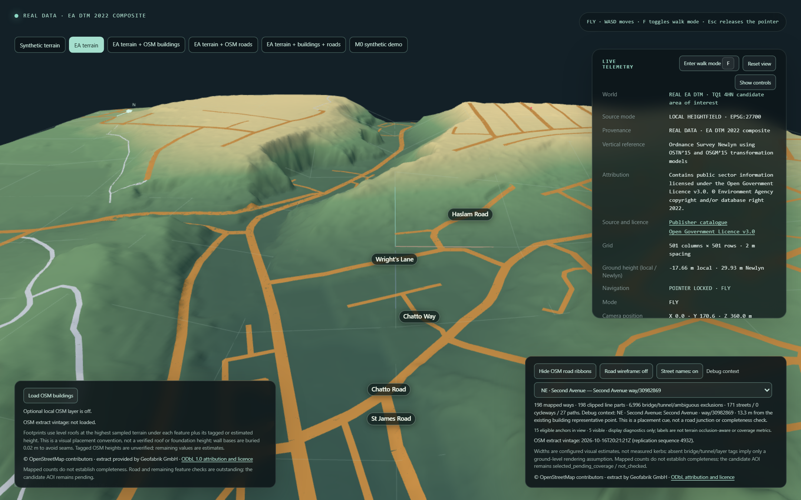
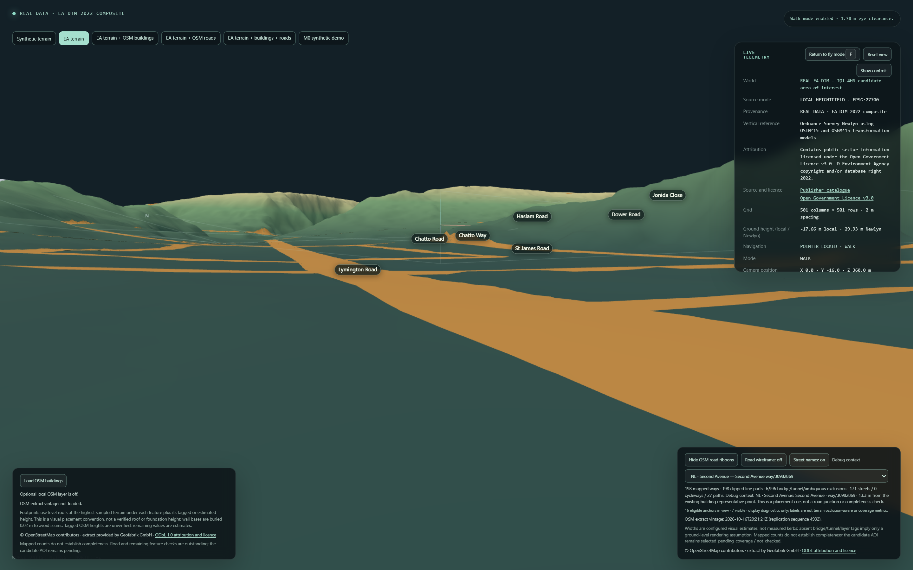

# TVW-015: Optional street-name labels

**Implementation status:** submitted for independent review. TVW-016 remains unauthorized.

## Result

The local real-terrain viewer now has an accessible, initially off **Street names** toggle when the OSM road layer is loaded and visible. Labels use only the validated package's `sourceTags.name`, trimmed at the edges. Each named clipped centerline part receives an arc-length midpoint anchor, sampled from the existing terrain grid and raised by 0.25 m. The renderer shows at most 20 labels within 500 m, chooses one per exact name deterministically, and culls labels behind the camera, outside the viewport, overlapping each other, or covering the interface panels.

The bounded overlay reuses 20 label nodes and one measurement node. It updates from the existing camera render loop, uses `textContent`, does not intercept pointer input, and clears on road hiding, package replacement, world changes, and disposal. Its status reports display eligibility and visible-label counts only. Labels are screen annotations and are **not depth-occluded** by terrain or buildings. Display counts do not measure road coverage.

The retained road package has 198 mapped features, 95 with a nonblank name, and 67 distinct trimmed names. These describe the retained extract only and are not a completeness claim. Existing OSM and Geofabrik attribution remains visible with roads. The synthetic default, M0 route, terrain-only route, and roads/buildings routes remain available; the share build contains no real road package or displayed road names.

## Browser evidence

The production Chromium run used Chrome 156.0.8078.4. The overview capture is 1440 × 900 CSS pixels at DPR 1.5 (2160 × 1350 PNG); the walk capture is 1920 × 1200 CSS pixels at DPR 1.5 (2880 × 1800 PNG). Both captures were produced by the real local production viewer. The overview visibly shows five street labels over the road ribbons; the ground-height walk view shows seven. The E2E test verifies at least three package-backed names in each view, terrain-relative walking clearance, movement, speed boost, reset, pointer-lock release, label toggle behavior, repeated toggles without duplicate nodes, world replacement, and the synthetic share route.

The separate labels-off/on frame sample used Chrome 156.0.8078.4 with ANGLE/Vulkan SwiftShader, a 1280 × 800 viewport, DPR 1.5, and one unchanged camera pose. Each condition used a 2 s warm-up and a 3 s sample. Both conditions measured a median interval of 116.7 ms/frame (8.57 FPS); there were 26 measured intervals and the document remained focused and visible. The sample saw 0 visible label nodes off and 3 on. This is a software-rendered observation from this run, not a hardware performance result or a pass/fail threshold. Full measurements are in [the JSON artifact](artifacts/TVW-015-label-overhead.json) and [its summary](artifacts/TVW-015-label-overhead.md).

## Verification

- `npm.cmd run typecheck` — passed.
- `npm.cmd run lint` — passed.
- `npm.cmd run format:check` — passed.
- `npm.cmd test` — passed, 259 tests across 17 files.
- `npm.cmd run build` — passed; Vite emitted its existing large-chunk advisory for the 715.80 kB application bundle.
- `npm.cmd run build:share` — passed with the same advisory.
- `npm.cmd run test:e2e:tvw015:real` — passed, 1/1, against the production local road package; no page errors, console errors, or external requests were observed.
- `npm.cmd run test:e2e:tvw015:share` — passed, 1/1; synthetic startup had no real road requests or names.
- `npm.cmd run test:e2e:tvw014:real` — passed, 3/3.
- `npm.cmd run test:e2e:tvw014:share` — passed, 2/2.
- `npm.cmd run test:e2e:tvw014:full` — 18 passed, 4 skipped, 1 failed. The TVW-015 real and share cases and the previously intermittent walk-mode navigation assertion passed. The remaining failure was a separate existing building E2E startup case: after `page.goto('/?world=torquay-poc-001&buildings=1')`, `.viewer-shell` did not appear within the 5 s assertion timeout. Later real-terrain/building/road and viewer cases passed in the same run, and the standalone TVW-014 production profiles passed.
- The isolated `walk mode follows the synthetic heightfield and preserves flight semantics` E2E passed 1/1 after a test-only `MutationObserver` was added to retain the brief “below the sampled terrain” feedback. It still presses the real `F` key and asserts that fly mode and position are preserved. No navigation behavior was changed.

The Python GIS pipeline and its source files were not changed by this issue. The AOI remains `selected_pending_coverage` / `not_checked`; neither the new labels nor existing mapped counts establish coverage or approve/freeze the AOI.

## Changed areas

- `src/geo/roadLabelCandidates.ts` and its unit tests implement deterministic candidate creation, midpoint placement, terrain sampling, culling, and collision selection.
- `src/app/createRoadLabels.ts`, `src/app/createApp.ts`, and `src/style.css` implement the bounded DOM overlay, accessible toggle, projected placement, and lifecycle cleanup.
- `tests/e2e/tvw015-real.spec.ts` and `tests/e2e/tvw015-share.spec.ts` cover production behavior; the legacy transient-feedback assertion in `tests/e2e/navigation.spec.ts` now captures the momentary status in test code only.
- `playwright.tvw015-real.config.ts`, `playwright.tvw015-share.config.ts`, `package.json`, and `README.md` document and run the isolated browser checks.

The TVW-014 benchmark artifact and historic captures are preserved. No source data, road package, schema, coordinate, or dependency was changed.
