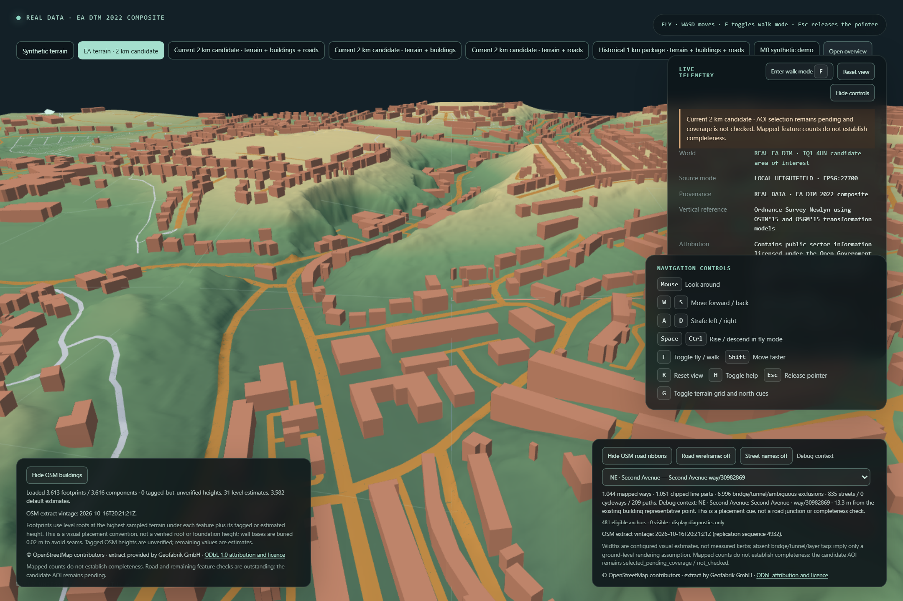
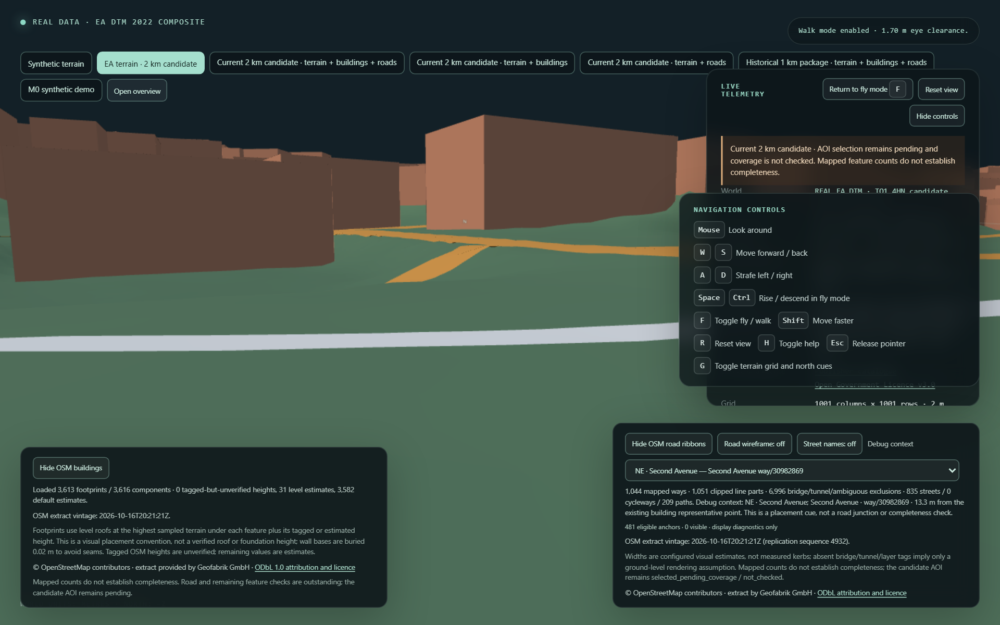

# 2 km terrain, buildings and roads handback

**Status:** implementation submitted for independent review. The overall AOI remains `selected_pending_coverage` / `not_checked`; mapped feature counts do not establish completeness.

## Published scene

The explicit `current_2km` route loaded one immutable release and used its readiness pointer, inventory, terrain, building and road assets. Release ID: `616e5f069acd6faa633a5ace3e04e1fee9d3d0fdb68c20e5ed0c29bb921a588a`. The inventory totals 97,426,386 bytes. The rendered terrain is 1,001 × 1,001 samples at 2 m spacing. The browser reported 3,613 building footprints and 1,044 road ways; those are imported counts, not a completeness finding.

The release's terrain heightfield is 4,008,004 bytes with SHA-256 `c61bd03d4172bffb07be596c4f63cc11a0681d0cacd884bb7dfcf3411be815af`. The road payload is 87,338,409 bytes with SHA-256 `cd44d5c9aa4f8ef107176b31b86dbfe4ad5f98271ccbcbc5a05d677a38385986`. The buildings payload is 6,015,566 bytes with SHA-256 `8c63da52a578207c2a11afa881fd56524df47e787bf6213d68c77b1784003a58`.

The browser fetches the fixed `ready.json` first, validates the inventory, and pins every subsequent layer request to that release. The production test confirmed terrain/buildings/roads used the same release, the historical overview was not requested, the optional-layer failure preserved terrain and allowed synthetic recovery, and missing readiness caused no real package request. The source road payload remains byte-identical. Its Float32 renderer conversion now reorients one non-degenerate face whose winding flips at renderer precision and omits one face that collapses to zero area at Float32 precision; both source triangles remain represented unchanged in the validated package.

## Browser evidence

The final isolated production Chromium profile passed 3/3 tests on Chrome `156.0.8078.4`. It ran at 1440 × 960 for the overview, then resized to 1280 × 800; DPR was 1.5 and the renderer capped the canvas buffer at DPR 1. The overview and outer-annulus camera poses, canvas dimensions, browser version, load duration, package bytes, draw calls, triangles and frame timings are recorded in [the browser evidence JSON](artifacts/Torquay-2km-browser-evidence.json).

The outer-annulus image is a low eye-level view at local `x=-86.25 m`, `z=595.9375 m`, 1.70 m above sampled ground. It faces bearing 336.5° at a -7.3° pitch; a road corridor recedes between nearby buildings with terrain visible around it. The nearest road centerline is about 10.3 m away. This demonstrates the added bounds and walk clearance; it is not a street-feature alignment or completeness check.

This run used SwiftShader (`ANGLE`, Vulkan 1.3.0), not a hardware GPU. Across the 5-second frame sample the median was 3.158 FPS, p50 frame time 316.7 ms, p95/p99/maximum 366.7 ms, 15 draw calls and 2,969,639 triangles. This software-rendered result is slow and is not evidence of hardware performance. The package's 97.4 MB inventory and nearly 3 million visible triangles are substantial for this headless renderer.

## Verification

From the repository root:

- `npm.cmd run typecheck` — passed.
- `npm.cmd run lint` — passed.
- `npm.cmd run format:check` — passed.
- `npm.cmd test` — 297 passed across 23 files.
- `npm.cmd run build` — passed as part of `npm.cmd run test:e2e:torquay2km:real`.
- `npm.cmd run build:share` — passed; inspected `dist/worlds`, which contains only the two synthetic fixture directories and no real, recovery-stage, or intermediate GIS assets.
- `npm.cmd run test:e2e:torquay2km:real` — final run 3 passed. Two interim screenshot-pose runs failed only at the newly added test-authored pitch expectations (`-2.0°` expected but `-25.8°` observed; then an `-8°..-15°` range expected but `-7.3°` observed). The final `-5°..-15°` pitch expectation passed and the run captured both active-scene screenshots while confirming release pinning, navigation, resize, outer-annulus travel, layer failure recovery, and no-readiness behavior.
- `git diff --check` — passed before handback.

The historical/share Playwright profiles were not rerun for this fix; share-build filtering was checked with `npm.cmd run build:share` and its focused filesystem tests. The accepted-spec deterministic repeated GIS build/hash comparison was also not run; the validated package and recovery stages were preserved without regeneration.

From `pipeline/`:

- `.venv\Scripts\python.exe -m pytest` — 293 passed, 1 skipped. The existing directory-symlink test skips because symlink creation is unavailable for this Windows account; the new Windows junction cases ran and passed.
- `.venv\Scripts\ruff.exe check .` — passed.
- `.venv\Scripts\ruff.exe format --check .` — passed.
- `.venv\Scripts\python.exe -m pip check` — passed (`No broken requirements found`).

The real production browser runs initially exposed a normal check on a valid source triangle after conversion to Float32. Inspection found one sub-millimetre face whose horizontal winding flipped and one whose vertices collapsed. The narrow renderer-only correction and unit regression now cover these cases without changing the road package bytes. A subsequent run exposed an outdated resize-test expectation: the real profile caps the WebGL backing buffer to DPR 1, so the assertion now waits for the capped dimensions rather than expecting DPR 1.5. The final production profile passed after both corrections and the final screenshot capture.

Vite emitted its existing native-config extension warning for `scripts/share-assets` and a large-chunk warning for MapLibre. Both builds completed successfully.

## Preservation

- The supplied source plan hash remains `144C9C704EA1C10FA2D503DBA3233B089528585BE7D36B7B94164D28BA40D571`.
- The user-provided installer hash remains `B4EDF70FA040968958C662FFB09FEEEB0EECA07759E6ED7742606BCC39F29FC6`.
- The original validated stage and its two recovery copies each remain 17 files / 106,957,125 bytes with the same inventory digest `E355DD2F36FC4A74F68E466B176602307A8CD3866CE963B3DFD91A3961037A49`.
- The historical 1 km package and prior milestone screenshots were not modified. The 2 km real package's readiness pointer, inventory and GIS payloads were not regenerated for this fix.

No AOI status, data source, dependency, source payload, or 1 km package was changed. The 2 km world remains an explicit local route; the synthetic default and share build remain available.
